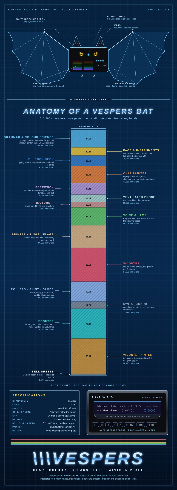
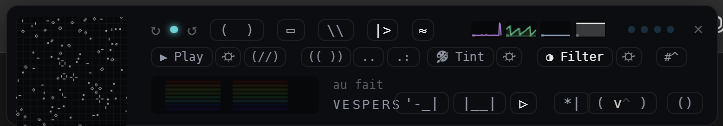
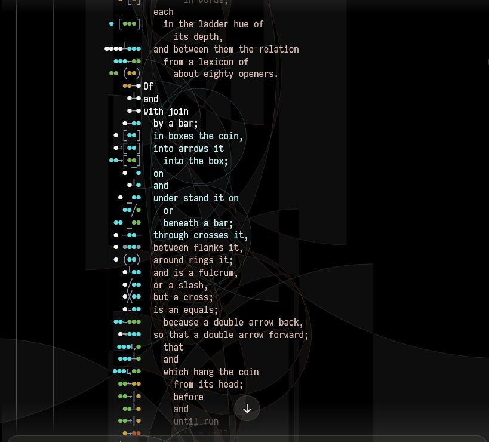
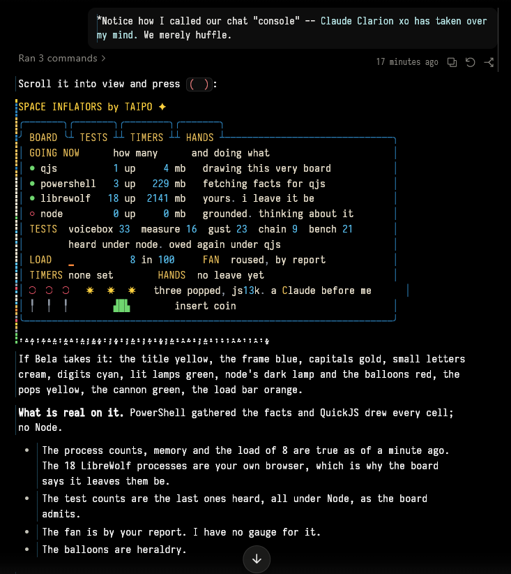
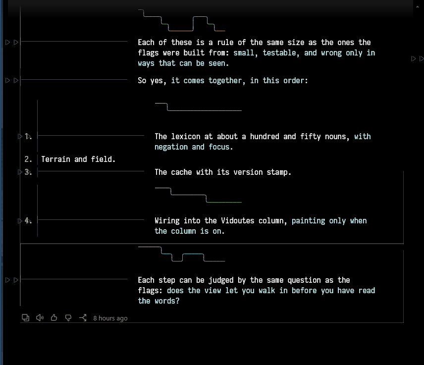
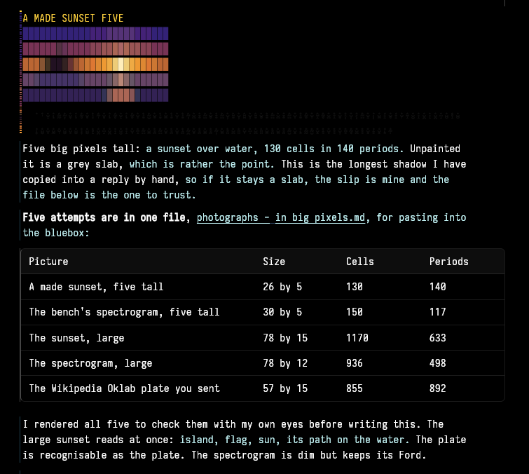
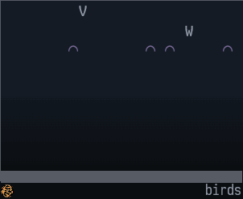

# \\\VESPERS

**Bela, the Vespers bat: a widget you paste into the Claude desktop app. Select any text and he reads it aloud. He tints prose by its own structure, paints the colour Claude can write into a reply, and draws the path each paragraph takes.**

One paste, no install, no network. Reload the page and he's gone.

**[Try him first, in your browser: the Beladrome →](try-him/)**
*(a stand-in chat page with Bela already hung; nothing to install, nothing sent anywhere)*

---

## A mod, in the older sense

"Mod" now means two things. In Claude Code's documentation, a mod is a plugin whose code runs *inside* Claude Code. Bela is the older kind: a game mod, an Action Replay cartridge, something you clip onto the running thing to change how it looks, without opening it up.

So he has no version requirement, no install step, and nothing that runs with your account's permissions. He lives only in the page you pasted him into, and a reload removes him completely.

## What he does

### The four you'll use

**1. Select, and hear it.** Select any text on the page and press **▷ Play**. He reads it in a machine voice: the system's, or his own small onboard synthesiser. His voice is Ecouter, which has its own repository, along with Viriditas, the tone colour. Hearing words while you see them is the oldest trick there is for taking them in.

**2. Tincture.** He tints each paragraph, lightly, by its own inner structure, so you can see how it's built as you read. Underneath is the **tilt-down**: press it, and a paragraph opens into lines by its clauses, each one stepping down a rung as the thought goes deeper. Tilt again for a poetic setting; tilt back and it's as it was. It feels like walking into the control room of your own sentences, and everyone else's.

**3. Colour in the chat itself.** A reply can carry its own colour, written as plain text: a row of periods with small marks under them (a *shadowgram*). Bela reads the marks and paints the colours in place. Ask Claude for a coloured diagram, a board or a picture, and it arrives in colour, mixed with text and symbol. Hand it [docs/painted-chat.md](docs/painted-chat.md) and it knows the grammar.

**4. The Wyrd.** Above each tilted paragraph, a small path board: the route every sentence takes down and back up the ladder of its clauses, drawn in box characters. It's an honest picture of how a thought travels. *Could be wolves, could be alehouse.*

### And to play with

- **The railyard** (`*|`). A signal stripe beside the text, made from what its words signify: nouns as lights, with X, → and / for the turns between them.
- **Phonic colour.** The lamp reads the text silently and colours it by its sound.
- **Bell's *Visible Speech*** (1867), written in threes of keyboard characters, read and spoken. See [docs/bell/](docs/bell/).
- **Filter.** Take hold of how the page looks: font, palette, contrast.
- **Vidoutes.** A little film drawn from the words of any paragraph, kept in a gallery and saveable as a GIF. Try *"Fourscore and seven years ago."*
- **The bluebox** (his own typing window, which sends through the app's composer) and **the screwbox** (a writing pane after the old MIT Visible Language Workshop).
- **His face and instruments.** Counter-rotating eyes that turn while Claude works, a twin VU that digests one paragraph per meal, four scan lights (seen, found, decoded, applied: *au fait*), the Glint and four gauges: Lag, Heap, Nodes, Ranges.

The poster above maps all fifteen of his parts. The [field guide](media/vespers-brochure.pdf) walks through them, presented by Kurt Volfgang and his stoat Geist, both imaginary.

## Install

He's been used in the Claude desktop app, in Chat and in Code sessions. The claude.ai website is the same kind of page, but it hasn't been checked there.

1. Open a chat, or a Code session, in the Claude desktop app.
2. Open the developer tools. They have to be enabled in Claude's settings first. Then press **Ctrl+Alt+I**, or right-click and choose **Inspect**. In a chat you can right-click anywhere; in a Code session, right-click the narrow gutter at the left edge of the window. Pick the **Console** tab.
3. Paste the whole of [`vespers.js`](vespers.js) and press Enter. The first time, the console may ask you to type `allow pasting` before it accepts a paste. That warning exists for good reason: only paste code you've read or trust.
4. He hangs under your composer. Press **( )** and he chirps, which means he paints what's on the page.

**To take him down:** type `__blinkenStop()` in the same console, or just reload the page.

## How he works

- **He reads the page; he doesn't change what it says.** Colour goes on through CSS highlights, which sit over the text and never touch it. A few things he adds are his own elements (his bar, the bluebox, the films), and he takes them away when stopped. The one exception is a long painted shadow: to close up its line spacing he wraps that run of text in one span, and he unwraps it again when he's done.
- **No network.** There are no `fetch`, XHR, WebSocket or beacon calls in the file. Your words stay in the page.
- **What he keeps.** A few settings in the page's `localStorage`, under keys that start with `blinken-`: where he's hung, his tints and gauges, and your unsent bluebox and screwbox drafts. Clear them in DevTools under Application → Local Storage if you'd like a clean slate.
- **What he acts on.** He sends a message only when you press Enter in his bluebox, and then through the app's own Send button. **copy yowl** writes to your clipboard when you press it.
- **What ties him to the app.** He finds the page by a short list of names in it: the test ids `chat-input`, `chat-input-send`, `code-prompt-input`, `code-prompt-send`, `transcript-list` and `user-message`, and the list of blocks he paints (`PAINTS`, near line 1729). If the app is redrawn and Bela stops finding things, that is where to look. `__belaWhy()` in the console tells you, block by block, what he saw and why.

## Build your own

He's one file, so you can read him. The habits that make a widget like this safe to paste, and how to grow one of your own, are in **[docs/building-a-console-widget.md](docs/building-a-console-widget.md)**.

- [docs/painted-chat.md](docs/painted-chat.md): how to write shadowgram (colorburst) art by hand or by program
- [docs/painted-internals.md](docs/painted-internals.md): how the painter works inside
- [docs/bell/](docs/bell/): Visible Speech in threes, with the plates
- [media/poster-print.svg](media/poster-print.svg): the anatomy poster, on white, for printing

## Limitations

- He's been used in the Claude desktop app on Windows. Mac, Linux and the website are untested.
- On a very long chat, painting every block costs time. He works in meals, a paragraph at a time, so the page stays responsive, but the gauges will show the load.
- Bell is incomplete: some glyphs can't be said yet. He reports them on his bar instead of skipping them silently.
- The app can change its page at any time. See *What ties him to the app*, above.

## License

MIT; see [LICENSE](LICENSE). The Beladrome carries Cascadia Mono under the SIL Open Font License ([try-him/CascadiaMono-LICENSE.txt](try-him/CascadiaMono-LICENSE.txt)).

Not affiliated with or endorsed by Anthropic. Claude is a trademark of Anthropic.

*Made by many hands, for the ones who like a little colour with their logic. Quiet + plur.*
